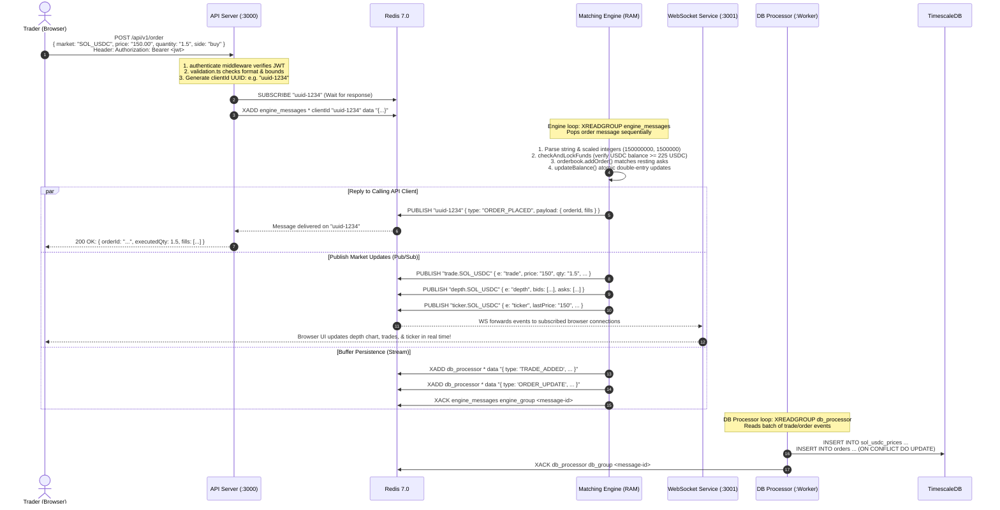

# Module 00 — Exchange Blueprint & System Architecture

> **A Masterclass in High-Throughput Financial Systems Architecture**  
> *"If you build an exchange like a traditional web application, it will die under market volatility, dead-lock its database, and leak customer funds. This module breaks down the first principles of why centralized exchanges are architected with in-memory event-sourcing and how all 7 microservices in this repository connect to form an institutional-grade trading platform."*

---

## 1. Why Traditional CRUD Architecture Fails for Financial Exchanges

Most web developers begin building web applications using a standard Three-Tier CRUD architecture:
```
Client (Browser) ──HTTP──> API Server (Node/Django/Spring) ──SQL──> Relational DB (Postgres/MySQL)
```

In a blog, e-commerce shop, or social network, this works well. When a user buys a pair of shoes:
1. `BEGIN TRANSACTION;`
2. `SELECT stock FROM products WHERE id = 1 FOR UPDATE;`
3. `UPDATE products SET stock = stock - 1 WHERE id = 1;`
4. `INSERT INTO orders ...;`
5. `COMMIT;`

### Why This Fails in an Exchange:

#### 1. The Mutex / Lock Bottleneck
In an exchange, every market (e.g., `SOL_USDC`) has a single, highly contested shared data structure: **the Order Book**.
If 5,000 traders submit limit and market orders during a price spike:
- In a SQL database, placing an order requires locking the order book rows (`SELECT ... FOR UPDATE`).
- Transaction 2 must wait for Transaction 1 to commit and write to disk.
- PostgreSQL disk write latency (even with fast NVMe SSDs) is ~2ms–10ms per fsync commit.
- **Max Throughput**: $\frac{1000\text{ ms}}{5\text{ ms}} \approx 200\text{ orders per second}$.
- In modern crypto markets, peak traffic exceeds **50,000 to 100,000 orders/sec**. Under database row locking, your API threads exhaust their connection pool, queues back up, latency explodes to 30 seconds, and transactions time out.

#### 2. The Floating-Point Rounding Catastrophe
Standard database and programming language floats (`float4`, `float8`, JavaScript `number` based on IEEE 754 double precision) cannot accurately represent base-10 decimal fractions.
```javascript
0.1 + 0.2 === 0.30000000000000004 // true!
```
If an exchange calculates fees or trades using native floating-point math:
- $100.50 \times 3.7\text{ SOL} = \$371.85$.
- A rounding error of $\$0.0000000001$ per trade across 5 million trades per day causes thousands of dollars of phantom balance discrepancies. Over months, balances will not balance against deposits, creating insolvency.

#### 3. The Race Condition Nightmare (Concurrency Overfills)
Imagine two buyers submit buy orders at the exact same millisecond:
- Order A: Buy 10 SOL @ $150
- Order B: Buy 10 SOL @ $150
- Order Book has only 10 SOL for sale @ $150.
If two threads process these requests concurrently:
- Thread 1 checks: "Is 10 SOL available? Yes."
- Thread 2 checks: "Is 10 SOL available? Yes."
- Both threads execute the fill against the seller's 10 SOL.
- **Result**: 20 SOL was bought, but only 10 SOL existed. The exchange has created 10 SOL out of thin air!

---

## 2. The Core Architecture Pattern: In-Memory Single-Threaded State Machine

To solve all three issues above, world-class exchanges (from NASDAQ and the London Stock Exchange to Binance and Backpack) utilize the **LMAX Disruptor Pattern / Event-Sourced In-Memory State Machine**.

```
                           ┌──────────────────────────────────────────────┐
                           │            MATCHING ENGINE (RAM)             │
                           │  - Single Node.js thread                     │
┌─────────────────┐        │  - Zero DB queries in hot path               │
│ Redis Stream    │───────>│  - Deterministic processing                  │
│ "engine_messages"        │  - All Orderbooks in RAM                     │
└─────────────────┘        │  - All Balances in RAM Map                   │
                           │  - Scaled Integer arithmetic only            │
                           └──────────────────────┬───────────────────────┘
                                                  │
                 ┌────────────────────────────────┴──────────────────────────────┐
                 ▼                                                               ▼
    ┌──────────────────────────┐                                   ┌───────────────────────────┐
    │  Redis Pub/Sub (IPC)     │                                   │ Redis Stream              │
    │  - depth.SOL_USDC        │                                   │ "db_processor"            │
    │  - trade.SOL_USDC        │                                   │ (Async persistence queue) │
    │  - ticker.SOL_USDC       │                                   └─────────────┬─────────────┘
    │  - {clientId} (API RPC)  │                                                 │
    └──────────────────────────┘                                                 ▼
                                                                   ┌───────────────────────────┐
                                                                   │ DB Processor Worker       │
                                                                   │ ──> PostgreSQL/TimescaleDB│
                                                                   └───────────────────────────┘
```

### The 4 Pillars of This Design:

1. **State Lives Exclusively in RAM**:
   - Order books (`bids`, `asks`) are pure in-memory JavaScript objects/arrays.
   - User account balances (`available`, `locked`) are stored in an in-memory `Map<string, UserBalance>`.
   - RAM operations take **nanoseconds**, whereas database reads take **milliseconds**.
2. **Strictly Single-Threaded Message Consumption**:
   - The Matching Engine runs on a single event loop.
   - It reads requests from an append-only queue (Redis Stream `engine_messages`) sequentially: **one message at a time**.
   - Because message execution is serialized, **race conditions are mathematically impossible**. No locks, no mutexes, and no deadlocks are required.
3. **Scaled Integer Precision Math**:
   - The engine never works with floating-point numbers.
   - All currencies are scaled by a constant integer factor: $\text{SCALE} = 1,000,000$ (6 decimal digits).
   - $\$150.25$ is represented as integer `150250000`.
   - $3.5\text{ SOL}$ is represented as integer `3500000`.
4. **Decoupled Asynchronous Persistence**:
   - The matching engine does **not** write to PostgreSQL during trade execution.
   - Instead, as soon as a trade matches, it pushes a lightweight event into Redis Stream `db_processor` and publishes real-time market updates to Redis Pub/Sub.
   - A separate background service (`db-processor`) reads the stream and writes to PostgreSQL / TimescaleDB at its own pace. If PostgreSQL is undergoing maintenance or running slow, the engine runs at full speed without pause.

---

## 3. Global System Topology: The 7 Core Microservices

Here is the complete topology of this repository:

```mermaid
graph TD
    Browser["Client Browser (Next.js Frontend)"]
    
    subgraph Edge Layer
        Nginx["Nginx Reverse Proxy (:80, :443)"]
    end

    subgraph Application Gateway Layer
        API["REST API Server (:3000)"]
        WS["WebSocket Gateway (:3001)"]
    end

    subgraph Message Bus & Cache Layer
        Redis[("Redis 7.0<br/>Streams + Pub/Sub + Key-Value")]
    end

    subgraph Core Trading Execution
        Engine["Matching Engine (Stateful RAM)"]
    end

    subgraph Liquidity Simulation
        MM["Market Maker Bot (Virtual Traders)"]
    end

    subgraph Data Persistence Layer
        DBProc["DB Processor Worker"]
        Timescale[("TimescaleDB (PostgreSQL 14)<br/>Hypertables + Materialized Views")]
    end

    Browser -->|HTTP REST / Cookies| Nginx
    Browser -->|WSS Realtime Feeds| Nginx
    Nginx -->|Proxy HTTP| API
    Nginx -->|Proxy WS| WS

    API -->|1. Validate Request| API
    API -->|2. XADD engine_messages| Redis
    API <--|3. Subscribe clientId (RPC)| Redis

    Engine -->|XREADGROUP engine_messages| Redis
    Engine -->|Publish client response / PubSub| Redis
    Engine -->|XADD db_processor| Redis
    Engine -->|Periodic Snapshot| EngineDisk[("Disk: snapshot.json")]

    WS -->|Subscribe depth, trade, ticker| Redis
    WS -->|Verify Ticket| Redis
    
    DBProc -->|XREADGROUP db_processor| Redis
    DBProc -->|Insert Trades & Orders| Timescale
    DBProc -->|Refresh Kline Views| Timescale

    MM -->|HTTP REST Orders (Bypass Token)| API
```

### Role of Each Component:

| Microservice | Directory | Port | Statefulness | Primary Responsibility |
|---|---|---|---|---|
| **Frontend** | `frontend/` | 3005 (or Vercel) | Stateless | Responsive trading terminal built on Next.js 14, TradingView lightweight charts, orderbook depth chart, trade feeds, and Razorpay fiat modal. |
| **REST API** | `api/` | 3000 | Stateless | Express.js API gateway. Authenticates requests via JWT, rotates refresh sessions in DB, enforces rate limits, initiates Razorpay orders, and dispatches engine commands via Redis. |
| **WebSocket** | `ws/` | 3001 | Stateless Gateway | Real-time WebSocket server. Validates 60-second tickets, bridges Redis Pub/Sub channels to connected browsers, and handles ping/pong heartbeats. |
| **Engine** | `engine/` | - (Internal) | **Stateful (RAM)** | Core order matcher. Maintains order books and user balances in memory. Consumes messages sequentially from Redis Stream `engine_messages`. |
| **DB Processor** | `db/` | - (Internal) | Stateless Worker | Drains trade and order events from Redis Stream `db_processor` and writes them into TimescaleDB. Manages automatic continuous aggregate refreshes. |
| **Market Maker** | `mm/` | - (Internal) | Stateless Bot | Simulates realistic liquidity by running 4 automated trading bots (Market Maker, Momentum, Reverter, Scalper) creating tight spreads and organic order volume. |
| **Shared** | `shared/` | - (Package) | Types & Constants | Cross-service TypeScript contracts defining message schemas, event payloads, and API response structures. |
| **TimescaleDB** | Container | 5432 / 5433 | Persistent Storage | PostgreSQL engine with Timescale extension. Stores user accounts, sessions, deposits, orders, and time-series trade prices with retention policies. |

---

## 4. Complete Lifecycle of an Order: Trace from Browser to Database

To understand the system deeply, let us trace every step of what happens when a user clicks **"Buy 1.5 SOL @ 150.00 USDC"** in the trading UI:



### Detailed Breakdown of the Steps:

1. **Browser Submission**: The client sends a JSON payload to `POST /api/v1/order`. Axios attaches the JWT Access Token in the `Authorization: Bearer <token>` header.
2. **API Gatekeeper Validation**:
   - `authenticate.ts` validates the JWT signature and extracts `userId`.
   - `rateLimit.ts` checks that the user has not exceeded 120 order actions per minute.
   - `validation.ts` validates that market is `"SOL_USDC"`, price and quantity are positive numbers within sanity limits.
3. **The Ephemeral RPC Bridge**:
   - The API generates a unique ephemeral ID: `clientId = crypto.randomUUID()`.
   - **Crucial Pattern**: The API *first* subscribes to Redis channel `clientId`, and *then* pushes the order command into Redis Stream `engine_messages`.
   - Why subscribe first? If you push to the stream before subscribing, a super-fast engine might match and publish the answer before the API finishes subscribing, causing the API to hang and time out after 10 seconds!
4. **Engine Consumption**:
   - The Engine sits in an `XREADGROUP` blocking loop with a 1,000ms block window.
   - It receives the message containing `clientId` and the command payload.
5. **Deterministic In-Memory Execution**:
   - Converts `"150.00"` to scaled integer `150000000`.
   - Converts `"1.5"` to scaled integer `1500000`.
   - Calculates total cost: $1.5 \times 150 = 225\text{ USDC} = 225000000\text{ scaled units}$.
   - Checks user balance: if `available < 225000000`, throws `"Insufficient funds"` and replies with `ORDER_REJECTED`.
   - Locks the funds: `available -= 225000000; locked += 225000000;`.
   - Invokes `orderbook.addOrder()`.
6. **Matching & Fill Execution**:
   - Checks resting asks in price-time priority.
   - If an ask matches, fills are recorded.
   - Balances are settled: buyer receives SOL, seller receives USDC, locked funds are released.
   - **Price Improvement Refund**: If the buyer placed a limit order at $155 but the resting ask was at $150, the $5 per unit difference is unlocked and returned to the buyer's available USDC.
7. **Broadcast & Persistence Outbox**:
   - Sends the response directly back to the API via Redis Pub/Sub channel `clientId`.
   - Publishes real-time market data (`trade.SOL_USDC`, `depth.SOL_USDC`, `ticker.SOL_USDC`) to Redis Pub/Sub for WebSocket distribution.
   - Pushes trade and order updates into Redis Stream `db_processor` with `TRIM MAXLEN ~10000`.
   - Acknowledges the message: `XACK engine_messages engine_group <id>`.
8. **Asynchronous Database Write**:
   - Background `db-processor` consumes the event from `db_processor`.
   - Executes parameterized `INSERT INTO sol_usdc_prices` and `orders`.
   - Calls `XACK db_processor db_group <id>`.

---

## 5. Security Architecture & Threat Vectors

A centralized exchange is a primary target for malicious actors. Our architecture implements defensive security across every layer:

```
┌────────────────────────────────────────────────────────────────────────┐
│                        DEFENSE IN DEPTH MATRIX                         │
├───────────────────┬────────────────────────────────────────────────────┤
│ THREAT VECTOR     │ MITIGATION IMPLEMENTED                             │
├───────────────────┼────────────────────────────────────────────────────┤
│ JWT Stolen by XSS │ Short-lived Access Token (15m TTL).                │
│                   │ Refresh Token in HttpOnly, SameSite=Strict cookie. │
│                   │ WebSocket authenticated via one-time 60s ticket.   │
├───────────────────┼────────────────────────────────────────────────────┤
│ Credential        │ Account Lockout: 5 failed attempts locks user for  │
│ Stuffing / Brute  │ 15 minutes in Redis.                               │
│ Force Logins      │ IP and User Rate Limiting on /auth endpoints.      │
├───────────────────┼────────────────────────────────────────────────────┤
│ Timing Attacks on │ Razorpay webhook signature verified using          │
│ Payment Signatures│ `crypto.timingSafeEqual` over fixed-length buffers.│
├───────────────────┼────────────────────────────────────────────────────┤
│ Zombie / Dead     │ Server-side ping/pong heartbeat every 30s.         │
│ WebSocket Sockets │ Force termination if pong is not received.         │
├───────────────────┼────────────────────────────────────────────────────┤
│ Replay Attacks    │ On-ramp messages require unique `txnId`.           │
│ on Engine Restarts│ Replayed events in Redis streams are skipped.      │
├───────────────────┼────────────────────────────────────────────────────┤
│ Poison Messages   │ Corrupted stream messages are acknowledged and     │
│ Crashing Engine   │ routed to Dead-Letter Queue (`engine_dlq`).        │
└───────────────────┴────────────────────────────────────────────────────┘
```

---

## 6. Zero-Data-Loss Guarantees: Snapshots & Stream Replays

A critical question in in-memory architectures is:  
**"What happens if the server suddenly loses power or the container is killed?"**

If memory is wiped, how do we guarantee that user balances and resting orders are not lost?

### The Two-Fold Recovery Model:
1. **Periodic Atomic State Snapshots**:
   - Every 30 seconds, if the engine state has been modified (`_dirty === true`), the engine serializes its entire RAM state (`orderbooks`, `balances`, `processedTxns`, and `lastProcessedStreamId`).
   - It writes to `./snapshot.tmp.json` first.
   - It then atomically renames `./snapshot.tmp.json` to `./snapshot.json`.
   - **Why atomic rename?** If the server crashes mid-write, the existing `snapshot.json` remains uncorrupted.
2. **Redis Streams Crash Recovery Replay**:
   - Redis Stream messages are **persisted to disk** via Redis AOF (`appendonly yes`).
   - The snapshot records the exact `lastProcessedStreamId` (e.g. `1712850000000-0`).
   - On reboot, the engine loads `snapshot.json`.
   - It checks Redis Stream `engine_messages` for any messages with IDs greater than `lastProcessedStreamId` that were either unacknowledged or arrived after the snapshot.
   - It replays those events through `engine.process()`.
   - State is perfectly restored to the millisecond before the crash. Not a single trade or balance change is lost!

---

## 7. Mental Model Summary: How to Read the Codebase

As you explore the modules that follow, keep this mental map in mind:

- **Need to know how money is represented without rounding errors?**  
  $\rightarrow$ Read [Module 01: Precision Math & Financial Arithmetic](file:///c:/webdevcode/PROJECTS/Centralised-Exchange/notes/01_PRECISION_MATH_AND_FINANCIAL_FOUNDATIONS.md)
- **Need to know how the order book matches buyers and sellers in FIFO order?**  
  $\rightarrow$ Read [Module 02: The Order Book & Matching Algorithm](file:///c:/webdevcode/PROJECTS/Centralised-Exchange/notes/02_THE_ORDER_BOOK_AND_MATCHING_ALGORITHM.md)
- **Need to know how balances are locked, settled, and price-improved in RAM?**  
  $\rightarrow$ Read [Module 03: The Matching Engine Core State Machine](file:///c:/webdevcode/PROJECTS/Centralised-Exchange/notes/03_THE_MATCHING_ENGINE_CORE_STATE_MACHINE.md)
- **Need to know how Redis Streams and atomic snapshots prevent crashes and data loss?**  
  $\rightarrow$ Read [Module 04: Crash Recovery, Snapshots & Redis Streams](file:///c:/webdevcode/PROJECTS/Centralised-Exchange/notes/04_CRASH_RECOVERY_SNAPSHOTS_AND_REDIS_STREAMS.md)
- **Need to know how the API Gateway routes requests and RPCs to the Engine?**  
  $\rightarrow$ Read [Module 05: API Gateway Routing & Request Lifecycle](file:///c:/webdevcode/PROJECTS/Centralised-Exchange/notes/05_API_GATEWAY_ROUTING_AND_REQUEST_LIFECYCLE.md)
- **Need to know how auth sessions, JWTs, cookies, and account lockouts work?**  
  $\rightarrow$ Read [Module 06: Enterprise Authentication & Session Security](file:///c:/webdevcode/PROJECTS/Centralised-Exchange/notes/06_ENTERPRISE_AUTHENTICATION_AND_SESSION_SECURITY.md)
- **Need to know how Razorpay INR fiat deposits are verified and minted?**  
  $\rightarrow$ Read [Module 07: Fiat Onramp & Payment Gateway Integration](file:///c:/webdevcode/PROJECTS/Centralised-Exchange/notes/07_FIAT_ONRAMP_AND_PAYMENT_GATEWAY_INTEGRATION.md)
- **Need to know how the WebSocket streaming gateway handles real-time data?**  
  $\rightarrow$ Read [Module 08: Real-Time WebSocket Gateway & PubSub](file:///c:/webdevcode/PROJECTS/Centralised-Exchange/notes/08_REALTIME_WEBSOCKET_GATEWAY_AND_PUBSUB.md)
- **Need to know how TimescaleDB stores trades and builds candlestick charts?**  
  $\rightarrow$ Read [Module 09: Persistence, TimescaleDB & Candlestick Aggregation](file:///c:/webdevcode/PROJECTS/Centralised-Exchange/notes/09_PERSISTENCE_TIMESCALEDB_AND_CANDLESTICK_AGGREGATION.md)
- **Need to know how the 4-archetype market maker simulates real organic trading?**  
  $\rightarrow$ Read [Module 10: Market Maker Bot & Liquidity Simulation](file:///c:/webdevcode/PROJECTS/Centralised-Exchange/notes/10_MARKET_MAKER_BOT_AND_LIQUIDITY_SIMULATION.md)
- **Need to know how the Next.js trading UI renders live books and charts?**  
  $\rightarrow$ Read [Module 11: Frontend Architecture, Trading UI & State](file:///c:/webdevcode/PROJECTS/Centralised-Exchange/notes/11_FRONTEND_ARCHITECTURE_STATE_AND_TRADING_UI.md)
- **Need to know how Docker and Nginx orchestrate all containers in production?**  
  $\rightarrow$ Read [Module 12: Infrastructure, Containerization & DevOps](file:///c:/webdevcode/PROJECTS/Centralised-Exchange/notes/12_INFRASTRUCTURE_CONTAINERIZATION_AND_DEVOPS.md)
- **Need to brainstorm what-ifs, disaster recovery, and scaling to 100K ops/sec?**  
  $\rightarrow$ Read [Module 13: What-If Scenarios & Production Evolution](file:///c:/webdevcode/PROJECTS/Centralised-Exchange/notes/13_BRAINSTORMING_WHAT_IF_SCENARIOS_AND_PRODUCTION_EVOLUTION.md)
